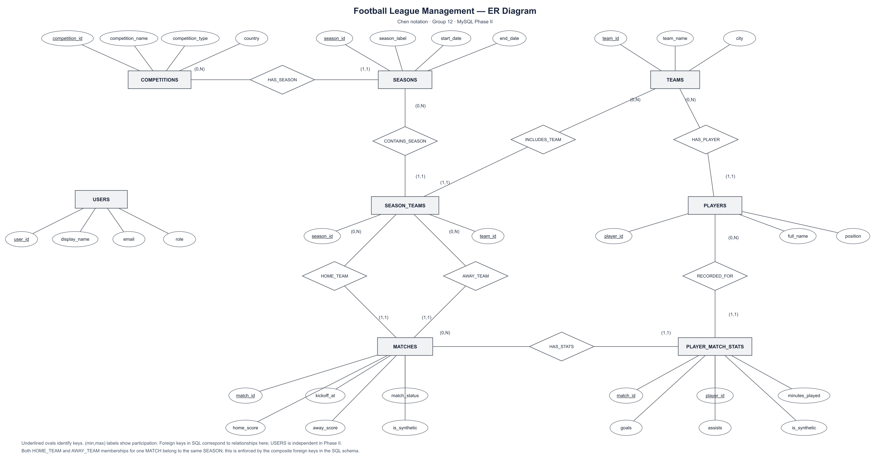

# ⚽ Touchline — Football League Management & Statistics

A full-stack football analytics application built with **Python, Flask, MySQL, and vanilla JavaScript**. Touchline brings match results, player statistics, searchable reports, and database management into a responsive dark interface.

Built for **SOFE 3700U — Data Management Systems, Group 20**, the project connects relational database design, SQL views, REST/JSON services, authentication, and external football data.

**Hosting:** the website and MySQL database run locally. **Current scope:** API-Football data for the **2023/24 Premier League matches between six selected clubs**, not the complete Premier League.

**Teammate setup:** follow [the shared fresh-database guide](setup/fresh_database/README.md). It includes four tested SQL scripts with the same sanitized football snapshot for every teammate, private local configuration, demo password setup and later code-update instructions. Use this installation path by itself; do not combine it with the original seed scripts or migrations below.

## 📑 Table of Contents

- [Technologies](#-technologies)
- [Features](#-features)
- [Roles and Access](#-roles-and-access)
- [How It Works](#-how-it-works)
- [API Integration and Data Scope](#-api-integration-and-data-scope)
- [Project Structure](#-project-structure)
- [Running the Project Locally](#-running-the-project-locally)
- [Demo Walkthrough](#-demo-walkthrough)
- [Testing](#-testing)
- [Learning Outcomes](#-learning-outcomes)
- [Future Improvements](#-future-improvements)
- [Documentation and Credits](#-documentation-and-credits)

## 📦 Technologies

| Layer | Technologies |
| --- | --- |
| Backend | Python 3.11+, Flask, Werkzeug password hashing |
| Database | MySQL 8.0.16+, PyMySQL, relational constraints and SQL views |
| Frontend | HTML, Jinja templates, CSS, JavaScript Fetch API |
| Visualization | Locally bundled Chart.js |
| Exports | Python CSV utilities and ReportLab PDF generation |
| External data | API-Football v3 through direct API-Sports; legacy football-data.org v4 |
| Configuration and testing | python-dotenv, unittest, SQLite for local API cache/quota tracking |

## 💡 Features

### 📊 Overview and Match Centre

- View six-club standings, team comparisons, recorded goals, and player goal leaders.
- Switch between completed results and scheduled fixtures and search participating clubs.
- Explore a charcoal interface with emerald/lime accents, club monograms, and a local stadium illustration.
- Use responsive navigation, keyboard focus indicators, labelled forms, and scrollable tables.

### 🔍 Report Studio

- Explore all ten course reports, including match details, standings, player totals, and home/away performance.
- Search across report fields or filter a specific column using backend SQL queries.
- Sort displayed tables and export filtered results as **CSV or PDF**.
- In API-Football mode, keep fictional and other-season matches out of analytics before aggregation.

### 🗂️ Data Workbench

- Administrators can create, read, update, and delete records across eight core entities.
- Validate required values, relationships, match scores, and player participation.
- Preserve imported historical player profiles separately from the original player editor.
- Protect provider-mapped matches from manual edits/deletion in API-Football mode.

### 🌐 Fixture and Statistics Imports

- Preview real fixtures before saving them to MySQL.
- Enrich saved matches with per-player minutes, goals, assists, and provider-returned team statistics.
- Process enrichment in batches of up to two completed fixtures.
- Review saved import history and available team statistics.
- Cache responses and track local API usage to reduce repeated requests.

## 🔐 Roles and Access

| Role | Demo identity | Access |
| --- | --- | --- |
| ADMIN | `admin.one@example.com` | Overview, reports/exports, Data Workbench, imports |
| USER | `reader.one@example.com` | Analytics overview and reports/exports; no CRUD or imports |
| GUEST | `guest.one@example.com` | Read-only six-team directory with name search and city filtering |

Guest accounts cannot access matches, player statistics, charts, reports, or exports. Permissions are enforced by the backend, not only by hiding interface elements. Passwords are generated locally; none are included in the repository.

## 🧱 How It Works

1. Flask authenticates the user against MySQL password hashes and records a server-side session.
2. Jinja renders the page appropriate to the user's role. JavaScript calls protected REST endpoints for analytics and management actions.
3. The backend validates requests, checks roles and CSRF tokens, and executes parameterized SQL.
4. Report endpoints query the original `v_*` views in legacy mode or the scoped `tl_v_*` views in API-Football mode.
5. An administrator requests an import preview. The server validates provider data and caches the snapshot.
6. Saving the reviewed snapshot persists records in a database transaction; charts and reports then read saved MySQL data.

The API cache is a local SQLite file. **MySQL remains the application database.** Imports are explicit actions; there is no automatic background synchronization or live-score polling.

## 🔄 API Integration and Data Scope

| Mode | Configuration | Season | Data |
| --- | --- | --- | --- |
| API-Football | `TOUCHLINE_PROVIDER=api-football`, `API_FOOTBALL_KEY` | 2023/24 | Fixtures/results, per-match player statistics, team statistics |
| Legacy football-data.org | `TOUCHLINE_PROVIDER=football-data.org`, `FOOTBALL_DATA_TOKEN` | 2025/26 | Fixtures/results alongside the original sample dataset |

The new provider uses league **39**, season **2023**, and only fixtures where both clubs are **Arsenal, Chelsea, Liverpool, Manchester City, Manchester United, or Tottenham Hotspur**. A complete home-and-away schedule for this subset contains 30 matches.

- Standings describe a **six-club mini-league**, not the official 20-club EPL table.
- Player totals cover imported appearances in those matches, not an entire 38-game season.
- Missing provider statistics remain unknown; the application does not invent goals, assists, or appearances.
- Original seed fixtures and player statistics are fictional. API-Football analytics exclude them, but the underlying historical records remain available for course/database review.
- API access and historical coverage depend on your provider account. Adding a key does not guarantee every endpoint is available.
- Apply the additive migration before enabling API-Football mode. The example environment deliberately defaults to legacy mode.

See the [installation and API guide](Phase_III/README.md) for migration, configuration, quota limits, and import steps.

## 📁 Project Structure

| Path | Purpose |
| --- | --- |
| `01_create_tables.sql` | Core MySQL schema; destructive if rerun on an existing installation |
| `02_insert_data.sql` | Sample users, clubs, players, seasons, and fictional statistics |
| `03_create_views.sql` | Ten original SQL reporting views |
| `04_test_queries.sql` | Queries and checks for the original seed dataset |
| `Phase_III/app.py` | Authentication, authorization, pages, team directory, CRUD, credential commands |
| `Phase_III/services.py` | Reports, CSV/PDF exports, and provider import routes |
| `Phase_III/api_football.py` | API-Football client, response validation, cache, quota ledger, previews |
| `Phase_III/provider_store.py` | Transactional persistence and provider identity mapping |
| `Phase_III/wsgi.py` | Flask entry point that registers application services |
| `Phase_III/05_phase3.sql` | Login credentials, sessions, and legacy import tracking |
| `Phase_III/06_api_football*.sql` | Provider migration plus read-only preflight and verification scripts |
| `Phase_III/templates/`, `Phase_III/static/` | Page templates, styles, scripts, local artwork, and Chart.js |
| `Phase_III/tests/` | Automated regression tests |
| `ER_diagram.svg`, `Relational_schema.svg` | Database design diagrams |
| `Phase_III/README.md` | Detailed Windows installation, execution, and troubleshooting guide |

## 🚦 Running the Project Locally

**Requirements:** Windows/PowerShell, Python 3.11+, a running MySQL 8.0.16+ server, a SQL client, and Git. Node.js is optional for JavaScript syntax checks.

For a new clone of this version:

```powershell
git clone --branch touchline-visual-upgrade https://github.com/ihassanrayan-max/sofe3700u-football-league-management.git
cd sofe3700u-football-league-management
```

Follow the [complete installation guide](Phase_III/README.md) to initialize or verify MySQL, apply the appropriate migrations, configure `Phase_III/.env`, and generate demo passwords.

Once the database and environment are configured:

```powershell
cd Phase_III
py -m venv .venv
.\.venv\Scripts\python -m pip install -r requirements.txt
.\.venv\Scripts\python -m flask --app wsgi run --host 127.0.0.1 --port 5000
```

Skip environment creation if `.venv` already exists. Open **http://127.0.0.1:5000/login** and use your locally generated credentials. Keep the terminal running; press **Ctrl+C** to stop.

**Existing installations:** preserve `.env`, credentials, and the database. Do not rerun scripts 01–02 or the first-run API-Football migration just to start an updated frontend.

## 🍿 Demo Walkthrough

1. Sign in as ADMIN and inspect the Overview and Match Centre.
2. Open Report Studio, search a report, sort its table, and export a filtered CSV/PDF.
3. Inspect core entities in Data Workbench. Demonstrate writes only with disposable test records.
4. In API-Football mode, preview/save fixtures, then preview/save a player-and-team-statistics batch.
5. Inspect saved history and team statistics, then revisit player reports.
6. Sign in as USER to demonstrate read-only analytics.
7. Sign in as GUEST to demonstrate the restricted team directory and its search/filter controls.

The diagram below documents the database design; it is not a screenshot of the application.



## 🧪 Testing

From `Phase_III`, with dependencies installed:

```powershell
.\.venv\Scripts\python -m unittest discover -s tests -v
```

Optional, with Node.js installed:

```powershell
node --check static/ui.js
node --check static/guest.js
node --check static/chart.umd.min.js
```

Tests cover role restrictions, report/export contracts, validation of provider data, preview/save protections, migration review, and demo password reset behavior. They use mocks or isolated in-memory data; passing them does not verify your live MySQL migration, provider subscription, or browser layout.

## 📚 Learning Outcomes

This group project applies:

- Relational modelling, primary/foreign keys, constraints, and SQL joins, subqueries, grouping, and views.
- A database-backed REST API with validation, session authentication, role checks, and CSRF protection.
- Asynchronous frontend updates and charts driven by saved database records.
- Adapting between API providers while preserving historical data and separate provider identities.
- Handling missing statistics, API quotas, transactional imports, and export formats.
- Maintaining frontend/backend permission boundaries with automated regression coverage.

## 🧪 Future Improvements

- Support all 20 clubs and selectable seasons after extending the data model and importer.
- Add more statistics views where provider coverage is available.
- Add automated browser accessibility and responsive-layout checks.
- Add deployment configuration and a production WSGI server.
- Add shared quota coordination before running the application on multiple hosts.

These are possible extensions, not currently implemented features.

## 📖 Documentation and Credits

- [Detailed Windows setup, execution, API imports, and troubleshooting](Phase_III/README.md)
- [Original relational schema](Relational_schema.svg)
- [Original entity relationship diagram](ER_diagram.svg)
- [API-Football](https://www.api-football.com/) — new-mode football data
- [football-data.org](https://www.football-data.org/) — legacy football data

Developed as a **Group 20 course project**. The database retains its original name, `group12_football_phase2`, for compatibility. Provider data remains subject to the respective provider's terms.
